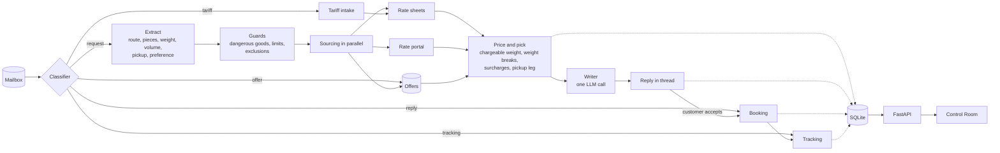

# AUTOPILOT by WRATHOFCODE

An autonomous air freight desk: it reads every customer request, prices it in code, replies with one all-in quote in a human voice, books on acceptance and answers tracking questions.

Built at START Hack Munich 2026 for the 5U AI challenge.

## How it works

One mailbox receives everything: customer requests, trucker and airline offers, rate desk answers, tariff updates, booking confirmations and tracking questions. A new request arrives every six minutes. The bot handles each one without a person in the loop.



Prices, dates and totals are computed in code. The language model writes the email around placeholders that code fills in, so it never invents a number.

Request lifecycle: `NEW → EXTRACTED → SOURCING → PRICED → QUOTED → ACCEPTED → BOOKED`.

## The agents

| Agent | Job | Language model |
|---|---|---|
| Classifier | Sorts every incoming mail | No |
| Extractor | Reads the request from the mail and its attachments (PDF, Word, Excel, images, voice, video) in many languages | Fallback only |
| Guards | Dangerous goods, size limits, excluded airlines, repeat and multi-shipment requests | No |
| Sourcing | Rate sheets, rate portal, airline and trucker offers, rate desk | No |
| Pricing | Chargeable weight, weight breaks, surcharges, pickup choice, outage handling | No |
| Writer | One reply email in the customer's language and tone | One call |
| Booking | Books the accepted offer by rate reference and confirms in the thread | No |
| Tracking | Answers status questions from our own booking records | No |
| Tariff intake | Turns new airline tariff mails into versioned prices | No |

## Scoring strategy

| Part | Points | Approach |
|---|---|---|
| Accuracy | 45 | All sources every time, the next weight break, minimum charges, the pickup leg, attached packing lists over mail totals |
| Cost | 40 | One small gateway call per quote, the email; everything else runs in code |
| Time | 15 | Sources are asked in parallel at once; the quote goes out as soon as the price is complete |
| Tracking | 10 | Every booking is stored with carrier, reference, status and arrival |
| Human email | 10 | Customer's language, first name, their tone, one option and one total |

A rejected quote costs about 100 points, so accuracy always wins over speed. Every lost round is reproduced as a test before the fix ships.

## Run it

```bash
python3.12 -m venv .venv && source .venv/bin/activate
pip install -r requirements.txt
cp .env.example .env            # fill in the team key
python scripts/fetch_kit.py     # downloads the start kit into data/kit/

python -m core.main             # the bot; DRY_RUN=1 logs instead of sending
uvicorn api.main:app --port 8000
cd ui && npm install && npm run dev   # http://localhost:5173
```

The Control Room shows the live 5U scoreboard; a network map of every lane with volume, customer acceptance, airline transit and delays, and the lanes where a better airline rate would win more business; shipments, booked and delivered; cargo claims; the agents; each request with its pipeline and the sent email, where every number set by code is highlighted; and the lessons from every lost round. It switches between English and German and between dark and light.

Two switches in the header change the running bot: the quote writer's model (gpt-4.1-mini or gpt-4.1) and daily shipment updates (off by default; when on, one status mail per booking a day and an arrival note, at most 10 mails a minute). They take effect only when the Control Room runs on the machine that runs the bot.

When a customer reports a lost or damaged shipment, the bot files claim `CLM-<ref>` with the airline that flew it and confirms to the customer. No person is involved.

Only one bot may run for the whole team. `data/bot.lock` stops a second one on the same machine; `touch data/STOP` stops it cleanly. `FAKE_DATA=1` runs the Control Room on demo traffic.

Attachments need two system tools: ffmpeg (voice and video) and Tesseract (scanned sheets and images). `python scripts/setup_speech.py` downloads the offline speech model once per machine.

## Configuration

All settings live in `.env`, which is never committed. `.env.example` lists them without values.

| Variable | Purpose |
|---|---|
| `FIVEU_API_KEY` | Team key for the 5U API and gateway |
| `FIVEU_BASE_URL`, `FIVEU_GATEWAY_URL`, `FIVEU_KIT_URL`, `FIVEU_BOARD_URL`, `FIVEU_PORTAL_UI` | 5U endpoints |
| `OUR_ADDRESS`, `RATE_DESK_ADDRESS`, `TRACKING_ADDRESS` | Mail addresses |
| `DRY_RUN` | `1` logs mails instead of sending |
| `KILL_SWITCH` | `1` blocks every outgoing mail and model call |
| `WRITER_MODEL`, `LLM_MODEL`, `LLM_FALLBACK_MODEL` | Models for the email and the fallback extractor |
| `POLL_INTERVAL_SECONDS` | Mailbox poll interval, never below the 5 second limit |
| `MAX_TOKENS_PER_RFQ` | Token budget per request |
| `DB_PATH`, `KIT_DIR` | Local database and start kit |
| `OUTAGE_MODE` | `0` turns off outage handling when the rate portal is down |
| `PICKUP_RULE` | How the trucker is chosen |
| `WHISPER_MODEL`, `FFMPEG`, `STT_CMD`, `VISION_FALLBACK` | Attachment reading |
| `FAKE_DATA` | Demo data for the Control Room |

## Folder structure

```
core/       bot: orchestrator, agents, pricing, mailbox, store
sourcing/   rate sheets, portal client, offers, booking, tariff ingestion
mail/       extraction rules, attachment reading, email writer, reply files
api/        FastAPI over the bot database
ui/         React Control Room: scoreboard, network map, agents, requests, lessons
scripts/    kit download, deployer, dry replay, secret scan, speech setup
tests/      pytest suites, with real mails and attachments from past rounds
docs/       API and portal notes, security review
data/       tariffs; the kit and databases stay local
schema.sql  shared tables
```

## Testing

```bash
pytest -q
```

The suite covers pricing, extraction in several languages, attachments, dangerous goods, booking, tracking and outage handling. Fixtures in `tests/fixtures/` are real mails from earlier rounds. Three OCR tests for one scanned rate sheet are known failures.

## Security

- The team key stays on the server. The UI talks only to our own API and never sees it.
- `scripts/scan_secrets.sh` runs before every push through a git hook.
- The bot only calls the 5U API. It never fetches links found in mails.
- All SQL uses parameters. Attachments are size-limited and the kit unzip rejects unsafe paths.

The full review is in [docs/SECURITY.md](docs/SECURITY.md).

## Documents

| File | Content |
|---|---|
| `docs/battle-plan.pdf` | Plan for the 22 hours |
| `docs/openapi.json` | 5U API specification |
| `docs/PORTAL.md` | Rate portal and board |
| `docs/mailbox.md` | Mailbox and threading |
| `docs/KIT.md` | Start kit and how the sheets are read |
| `docs/SOURCING.md` | Price sources and booking |
| `docs/SECURITY.md` | Security review |

## Team

| Name | Area |
|---|---|
| Amaan | Core bot and pricing (`core/`) |
| Aryan | Sourcing, portal and booking (`sourcing/`) |
| Aditi | Mail layer (`mail/`) |
| Rishabh | Control Room, API, integration and pitch (`api/`, `ui/`) |
