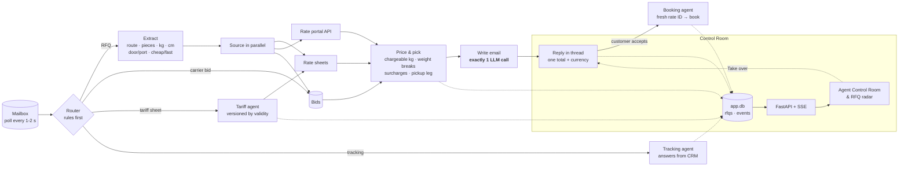

# AUTOPILOT by WRATHOFCODE

> **A digital air forwarder that quotes every air-freight RFQ all night: exact prices from code, one human-sounding email from a single small LLM call, and a radar where a person can take the controls at any moment.**

Built in 22 hours at **START Hack Munich 2026** for the **5U AI challenge**.

---

## What it does

One mailbox (`wrathofcode@hackloop.mail`). A new air-export RFQ arrives every 6 minutes. AUTOPILOT, on its own:

1. **Reads and routes** every email: customer RFQ, carrier bid, portal reply, tariff sheet, tracking question.
2. **Prices** each RFQ from 10 airline rate sheets, the rate-portal API and 2 to 5 carrier bids, all in plain code.
3. **Quotes one option** (cheapest or fastest, whichever the customer asked for) with **one all-in total and currency**, in the customer's thread, ideally **under 2 minutes**.
4. **Books by rate ID** when the customer accepts (rate IDs expire after 15 min).
5. **Answers tracking questions** from our own CRM.

> Code flies the plane. One LLM call does the talking. A human can grab the controls at any time.

## How it works



Every step writes one row to `events` and streams live to the UI, so we can see each decision and catch failed quotes. Failed quotes are the only sign that the setup has changed.

**RFQ lifecycle:** `NEW → EXTRACTED → SOURCING → PRICED → QUOTED → ACCEPTED → BOOKED → TRACKING`

## The agents

| Agent | Job | LLM? |
|---|---|---|
| **Router** | Classifies every incoming mail and hands it to the right agent | Rules first; LLM only if unsure |
| **RFQ** | Extracts, sources, prices, picks one option, writes and sends the quote | **One** call per quote (the email) |
| **Booking** | On acceptance: refreshes the rate ID if older than 15 min, books, confirms in thread | No |
| **Tracking** | Answers "where is my shipment?" from the CRM | No (template + data) |
| **Tariff** | Ingests new monthly airline tariffs as structured, versioned prices | No (parsed in code) |

## Scoring strategy

| Part | Points | How we win it |
|---|---|---|
| Price accuracy | **45** | Check *all three* sources every time. Chargeable weight = max(gross, Σvolume/6000), rounded up to 0.5 kg. Always test the next weight break up. Minimum charge, per-kg surcharges, flat fees, pickup leg for door-to-port. Quote at cost. |
| LLM cost | **40** | **Exactly one** small gateway call per quote: the email writer. Under 600 tokens in, `max_tokens` around 250, smallest model, about $0.0002. Zero calls earns zero cost points, so we never skip it. Router, extraction, pricing, tariffs and the dashboard use no LLM at all. Budget rules in `mail/README.md`. |
| Response time | **15** | Fire portal + bid requests in parallel at t=0. Quote at 2:00 if bids are in or sheets clearly win; else wait until 4:00; hard stop 5:15. |
| Tracking bonus | +10 | Every booking is logged with carrier, rate ID, status and ETA, so the answers come from data. |
| Human email bonus | +10 | The one LLM call goes where the jury reads: the customer's language, tone and thread. |

**Guardrails:** one quote per thread (unique outbox row), no acknowledgement emails, sanity gate (lb/inch mix-ups, density outside 20 to 1,000 kg/m³, price far from the portal's) sends the quote to a human for review.

## Team

| Who | Owns | Folder |
|---|---|---|
| **Amaan** | Core loop, state machine, pricing, option choice, cut-off timing | `core/` |
| **Aditi** | Mailbox poller, router, extraction, human email writing, tracking | `mail/` |
| **Aryan** | Rate sheets, portal client, carrier bids, booking, tariff ingestion | `data/` |
| **Rishabh** | Agent Control Room UI, API, dashboard, alarms, integration, pitch | `api/`, `ui/` |

## Run it

```bash
git clone https://github.com/Rishabh4691/WRATHOFCODE.git && cd WRATHOFCODE
cp .env.example .env                     # team key goes in FIVEU_API_KEY
python3.12 -m venv .venv && source .venv/bin/activate
pip install -r requirements.txt          # everything: bot, sourcing, API, tests

uvicorn api.main:app --port 8000         # control room API, reads app.db
FAKE_DATA=1 uvicorn api.main:app --port 8000   # same, with demo traffic in fake.db

cd ui && npm install && npm run dev      # http://localhost:5173
```

Tests: `pytest` (OCR tests for scanned sheets need `brew install tesseract`)

### Attachments, voice and video

Customers and truckers send the request or price as PDF, Word (.docx/.doc), Excel (.xlsx/.xls/.csv),
text, images, Outlook .msg, Apple Pages/Numbers, zip, mp3/wav/ogg voice notes and mp4 videos.
`mail/files.py` turns every one into text. Two system tools are needed besides `pip install -r requirements.txt`:

| | Windows (bot laptop) | Linux (AMD server) | macOS |
|---|---|---|---|
| ffmpeg (audio, video) | `winget install Gyan.FFmpeg` | `sudo apt install ffmpeg` | `brew install ffmpeg` |
| Tesseract (scans, images) | `winget install UB-Mannheim.TesseractOCR` | `sudo apt install tesseract-ocr` | `brew install tesseract` |

Then once per machine: `python scripts/setup_speech.py` downloads the speech model (faster-whisper,
about 460 MB for `small`, any language, offline, no gateway cost) and checks the tools.
`python scripts/setup_speech.py path/to/voice.mp3` prints what the bot reads from a file.
The bot loads the model in the background at start. Without faster-whisper it falls back to
Windows speech (`scripts/stt.ps1`, only installed languages) or `STT_CMD="your-tool {wav}"`.
Images that OCR cannot read go to one gateway vision call (`VISION_FALLBACK=0` turns it off).

| Setting | Default | Meaning |
|---|---|---|
| `WHISPER_MODEL` | `small` | `base` is about twice as fast, `medium` more accurate |
| `FFMPEG` | on PATH | full path to ffmpeg if it is not on PATH |
| `STT_CMD` | unset | own speech-to-text command, `{wav}` is the audio file |
| `PICKUP_ESTIMATE_SECONDS` | `100` | quote with the estimated truck price after this many seconds without a trucker price |

Bot (the live one): `python -m core.main`. `DRY_RUN=1` in `.env` logs instead of sending; set `DRY_RUN=0` to go live.
Only **one** bot may run for the whole team. A lock file stops a second one on the same machine, but nothing stops two laptops: agree who runs it. `touch data/STOP` stops it cleanly.
Replay one sample without sending: `PYTHONPATH=. python scripts/replay_dry.py tests/core/fixtures/mail/rfq_port_to_port.json`

Before every push: `./scripts/scan_secrets.sh`. Turn on the hook once per clone with `git config core.hooksPath .githooks` and git will refuse any push that fails the scan. Files uploaded on the GitHub website skip this check, so never upload `.env`-style files there.

### See the live bot from another laptop

The bot's database is on the laptop that runs it. On that laptop:
`uvicorn api.main:app --host 0.0.0.0 --port 8000`. On yours:
`cd ui && API_TARGET=http://<bot-laptop-ip>:8000 npm run dev`.
The Live scoreboard tab works anywhere, it reads 5U's board directly.

### Control room API

| Endpoint | What it returns |
|---|---|
| `GET /api/agents` | One card per agent: light, current task, tasks done, success, avg time, LLM cost, productivity |
| `GET /api/summary` | Totals for the header: RFQs, quoted, failed, median time, LLM per quote, booked value |
| `GET /api/rfqs` | Latest RFQs with status and 6-minute deadline |
| `GET /api/rfqs/{id}` | One RFQ with breakdown, sent email and full event timeline |
| `POST /api/rfqs/{id}/takeover` | `{"on": true}` takes the controls, `false` hands back. Core must skip sending when `rfqs.human_takeover = 1` |
| `GET /api/stream` | Server-sent events, one per new row in `events` |

Productivity = 50% success rate + 30% speed (vs. a per-agent target) + 20% low LLM cost (vs. $0.10 per task).

**How to log so the dashboard works:** write one `events` row per step. Use `status` `start` when a task begins, `ok` or `fail` when it ends (with `duration_ms`), and `info` for anything in between. Put the gateway cost of the email call in `llm_cost_usd`. `ts` is Unix seconds (`time.time()`). `success`/`done`/`sent` count as ok and `failed`/`error` count as fail, so small differences won't break the dashboard. The schema is in `schema.sql`. If your code already made the tables, the API adds any missing columns on start.

## Folder structure

```
.
├── core/       # the live bot: orchestrator, pricing, mailbox, classifier, portal, trucker (Amaan)
├── sourcing/   # rate sheets, portal client, bids, booking, tariff ingestion (Aryan)
├── mail/       # rules extraction, human email writer, gateway call, bot lock (Rishabh)
├── api/        # FastAPI + server-sent events over app.db (Rishabh)
├── ui/         # React + Vite + Tailwind: Agent Control Room (Rishabh)
├── data/       # tariffs.json; kit/ and app.db stay local
├── tests/      # pytest: core/, sourcing/, mail and api tests
├── scripts/    # kit download, dry replay, secret scan
├── docs/       # battle plan, API spec, mailbox, portal, kit, sourcing notes
└── schema.sql  # shared rfqs and events tables
```

Shared state: a single SQLite `app.db` (WAL mode) with tables `rfqs` and `events`
(`events`: `ts, agent, rfq_id, step, status, message, duration_ms, llm_cost_usd, data_json`; `agent` ∈ `router | rfq | booking | tracking | tariff`).

## Live status

_Last updated: Sat 21 Nov 2026_

**Done**
- [x] Repo, `.gitignore`, secret scanner with pre-push hook
- [x] Control room: API + UI, live stream, take over, fake-data mode
- [x] Core bot (Amaan, `core/`): poll, classify, extract, portal prices, trucker pickup, pick cheapest/fastest, one LLM call, reply in thread, outbox guard, supervisor
- [x] Sourcing (Aryan, `sourcing/`): 10 rate sheets in `data/tariffs.json`, portal client, bids, booking, tariff ingestion
- [x] Mail layer (Rishabh, `mail/`): rules extraction (no LLM for most RFQs), human email writer
- [x] Sheet prices feed the core bot (`core/agents/sheets.py`), so sheet-only airlines are quoted
- [x] Human email writer in the core bot (`core/agents/human_writer.py`): greeting by name, customer's language, one price, numbers set by code
- [x] One bot per machine (`data/bot.lock`); duplicate second bot removed

**Missing (by priority)**
- [ ] Accept -> book by rate ID -> confirmation in thread (core ignores "yes" today; `sourcing.book_option` + `mail.sender` are ready)
- [ ] Tracking answers from the CRM (+10 each)
- [ ] Airline bid requests and replies in the price race (`sourcing/bids.py` is ready, core only asks truckers)
- [ ] Tariff mails into `data/tariffs.json` (`sourcing.ingest_tariff_mail` is ready, core ignores tariff mails)
- [ ] Board watcher on `/v1/board/me` with alarms for rejected quotes
- [ ] OCR misreads three cells of the Danube JPG sheet (3 tests in `tests/sourcing`)
- [ ] Pitch, rehearsal x3, backup video (Sun 10:00 to 12:00)

## For the team

22 hours. One RFQ every 6 minutes. Every one we get right, fast and cheap is up to 100 points, and every one we miss is gone for good.

We're not trying to out-AI anyone. We win by being **exact where money is involved, human where people read, and awake when it breaks**. Ship small, commit often, keep `main` green, and when a quote fails at 3 a.m., that's the setup telling us what changed. Fix it in pairs, add a test, move on.

By 12:45 on Sunday we want a story: *"At 2 a.m. an RFQ landed, and AUTOPILOT answered it right, fast, cheap and in a human voice."*

**Autopilot engaged.**
