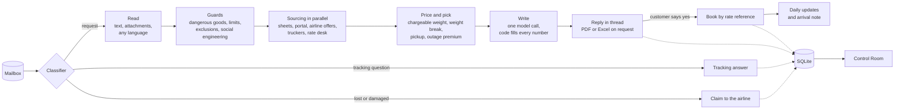

# AUTOPILOT features

AUTOPILOT answers every air freight request in the team mailbox on its own. It reads the request, prices it in code, replies with one all-in quote in the customer's language, books on a yes, keeps the customer informed, answers tracking questions and files cargo claims. No person is in the loop.

Status on 22 Nov 2026, 07:20 UTC: rank 7 of 14, 115 of 147 rounds accepted, round 151 accepted and booked on the current code.

## How one request flows

Code sets every price, date, weight and reference. The language model writes only the words around them, so it cannot invent a number.

## Reading requests

| Feature | Detail | Code |
|---|---|---|
| Rules first | Route, pieces, weight, volume, dimensions, pickup, ready date and preference are read by rules; the model is a fallback for missing fields only | `mail/extract.py`, `core/agents/rules_extractor.py` |
| Languages | English, German, French, Spanish, Italian, Polish, Dutch, Portuguese, Turkish, Korean, Chinese, Japanese and more. Korean, Chinese and Japanese preference and ready-date words are matched without word gaps | `mail/extract.py`, `mail/lang.py` |
| Attachments | PDF, Word, Excel, CSV, text, images (OCR, vision fallback), voice notes and video (offline speech model); an attached packing list wins over the mail | `mail/files.py`, `core/agents/attachments.py` |
| Units | kg and lb, cm, mm and inches, cbm and cubic feet, thousands written with spaces or apostrophes | `mail/extract.py` |
| Special requests | Repeat requests ("the same shipment as before"), several shipments in one mail, changed shipments after a quote, arrival deadlines, insurance, extra charges | `mail/repeat_request.py`, `mail/multilot.py`, `mail/insurance.py` |
| Unknown pickup site | "From our warehouse" without a postcode: every German airport is compared | `core/orchestrator.py` |

## Pricing and sourcing

| Feature | Detail | Code |
|---|---|---|
| Sources | Ten airline rate sheets, the rate portal, airline offers by mail, trucker offers, the rate desk | `sourcing/`, `core/agents/` |
| Price rules | Chargeable weight (volume × 167), the next weight break, minimum charges, surcharges, currency conversion, tariff valid on the ready date | `sourcing/`, `core/pricing/` |
| Choice | Cheapest or fastest as asked; the trucker by the 50/50 price and time rule | `core/agents/trucker.py` |
| Portal outage | Retries the portal, uses saved prices, and adds a learned premium for fastest requests: start +25 %, never below +21 %, moved by every board verdict | `core/agents/outage.py` |
| Tariff updates | New airline tariff mails become versioned prices | `core/agents/tariff_intake.py`, `sourcing/ingest.py` |

## Guards

| Guard | What it does |
|---|---|
| Dangerous goods | Reads mail and attachments; asks for the shipper's declaration and safety data sheet; "not restricted" counts as safe |
| Limits | Oversize and freighter-only pieces are flagged |
| Excluded airlines | "Any airline except X" is respected |
| Social engineering | Requests for keys, passwords or bank changes are never answered; outgoing mails are blocked if they contain a key |
| One quote per thread | An outbox guard stops a second quote in the same thread |

## Customer emails

| Feature | Detail | Code |
|---|---|---|
| One model call | Model `gpt-4.1-mini` by default, switchable in the Control Room. Placeholders are filled by code; drafts with own digits, a second price, alternatives or stiff phrases fall back to a template | `mail/writer.py`, `mail/gateway.py` |
| Customer's language | Greeting and sign-off in 22 languages. Outside English the model writes the opener, the preference word and the pickup and volume remarks itself; dates as `28.11.2026`, European number style | `mail/writer.py` |
| Human tone | First name, a reply to anything personal, their tone, one option, one total, no filler or emoji | `mail/writer.py` |
| Files on request | PDF, Word, Excel, CSV, text or image of the offer when asked; PDFs always carry the price as real text | `mail/reply_files.py` |

## After the quote

| Feature | Detail | Code |
|---|---|---|
| Booking | A yes books by rate reference (portal or airline mail) and confirms in the thread in the customer's language. "Book only the first shipment" books that one | `core/agents/booking.py`, `mail/multilot.py` |
| Tracking | Status questions are matched by booking reference, our reference, company, lane, weight and date; a question that names a destination only matches bookings to it | `core/agents/tracking.py` |
| Daily updates | Off by default. When switched on, each booked customer gets one status mail a day and an arrival note once the arrival date passes; at most 10 mails a minute, never in the first 150 s after a new request | `core/agents/updates.py` |
| Delay notice | An airline delay is passed to the customer first (`PROACTIVE_UPDATES=1`) | `core/agents/booking.py` |
| Cargo claims | A customer mail reporting a lost or damaged shipment files claim `CLM-<ref>` with the airline that flew it and confirms to the customer. The 5U mailbox reaches only carriers from the kit, so claims go to the airline, not an insurer | `core/agents/claims.py` |

## Control Room

Run `uvicorn api.main:app --port 8000` and `cd ui && npm run dev`, then open http://localhost:5173. `FAKE_DATA=1` shows demo traffic.

| Tab | Shows |
|---|---|
| Live scoreboard | The 5U board, every round's verdict and points, and the mails of a round |
| Network | World map of every lane (width = volume, colour = customer yes), busiest lanes, airline league (bookings, yes rate, transit, delays) and the lanes to raise with the airline. Filter by day, week, month, year |
| Shipments | Booked and delivered shipments with airline, arrival, price and updates sent |
| Claims | Every claim filed, with airline, customer and the customer's own words |
| Agent Control Room | One card per agent: current task, success, time, model cost |
| RFQs | Each request with its pipeline strip, price breakdown, the sent email with every code-set number highlighted, and the event timeline |
| Lessons | Every lost round with its cause, fix and commit |

Header switches:

| Switch | Effect |
|---|---|
| EN / DE | Interface language |
| Dark / Light | Theme, remembered per browser |
| 4.1 mini / 4.1 | The quote writer's model, read by the bot on every quote |
| Daily updates | Turns the shipment updates on or off |

The two bot switches write `data/settings.json`, so they change the bot only when the Control Room runs on the bot's machine.

## Security

The full 20-point review is in [SECURITY.md](SECURITY.md). In short: the team key stays on the server, all SQL uses parameters, the bot only calls the 5U API and never fetches links from mails, attachments are size-limited, CORS allows only the UI origin, and a secret scan runs before every push.

## Verification

Run on 22 Nov 2026 at 07:20 UTC on `main`.

| Check | Result |
|---|---|
| Full test suite | 867 passed; 3 known OCR failures on one scanned rate sheet |
| Native-language emails (`tests/test_mail_languages.py`) | 7 passed; English prompts and emails byte for byte unchanged in 16 cases |
| Updates and claims (`tests/core/test_updates_claims.py`) | 14 passed |
| Control Room API (`tests/test_api.py`) | 17 passed |
| Korean, Chinese, Japanese reading (`tests/test_multilingual_extract.py`) | 9 passed; old vs new extractor over 125 saved requests, only the 2 intended differences |
| Reply files (`tests/test_reply_files.py`) | 22 passed |
| Partial booking, tracking match, outage premium | 8, 2 and 13 passed |
| Live bot after the last push | Round 151 accepted and booked |
| UI build and `npm audit` | Builds; 0 vulnerabilities |
| Secret scan | Clean |

## Known limits

- The team key is in old commits (`env`, `env.env`); revoke it after the event.
- The outage premium is learned from verdicts; its upper bound is not known yet.
- Round 150 (`one_of_two`): two shipments in one mail were both quoted, but one price was off; the cause is still open.
- Three OCR tests fail on the scanned Danube rate sheet.
